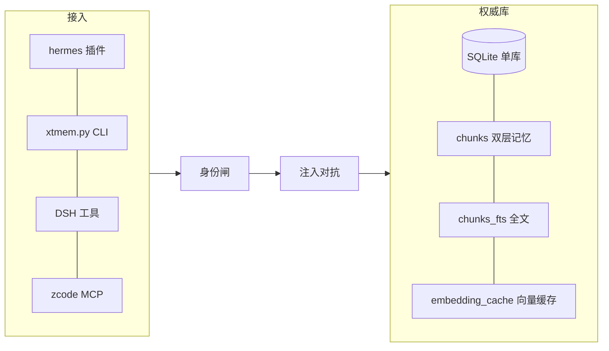
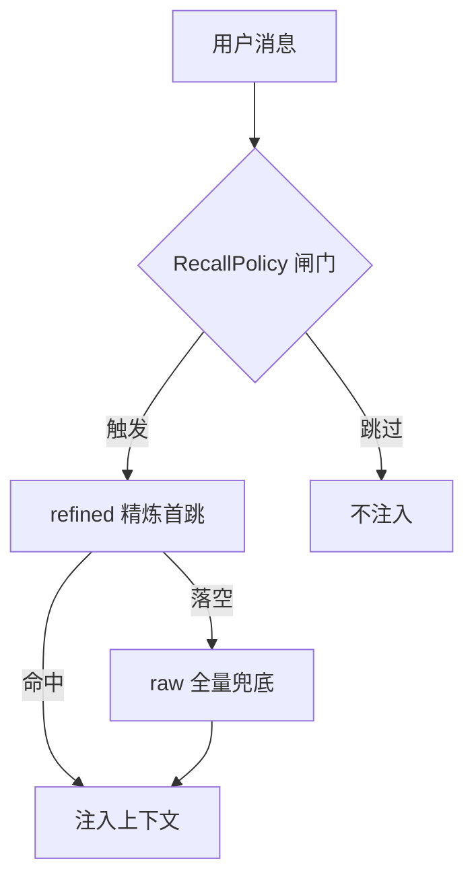
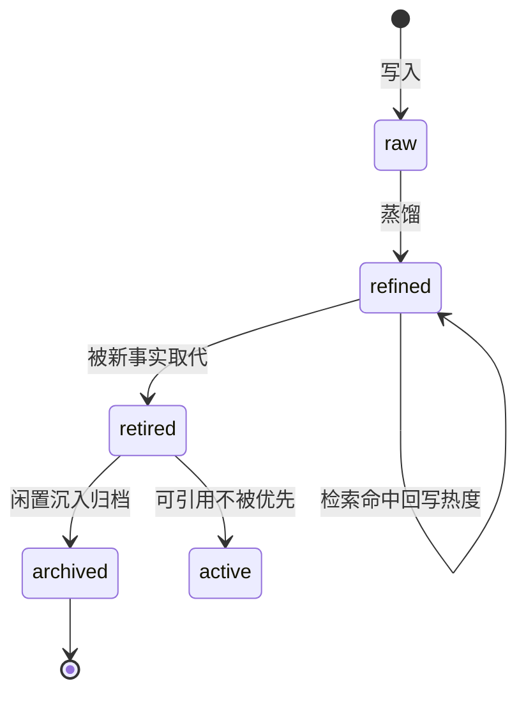

# XTMEM 白皮书 · 技术产品导向 v1

> **记忆是水，全楼通；人格是房，各自关门。**
> 多角色 AI 天团的共享记忆系统 · XTMEM
> assistant-a（personal）· 2026-09-03 · 按《书写指南 v2 技术+产品导向》产出

---

## 1. 摘要

XTMEM 是一套给**多个 AI 角色共用记忆**的基础设施。它不是"把大家变成一个人"的记忆合并器——恰恰相反，它让每个角色保持**独立的性格、语气与边界**，只把"记忆"这一件事收敛成**一座唯一权威的库**，让角色共享、互查、对账，又不互相侵犯。

**一句话定位**：给"多角色 / 多端共享记忆"的正解——记忆与人格解耦、共享但不串人格。

**三个数字（2026-09-03 实测口径）**：
- **3661 条记忆**（raw 全量 2979 / refined 精炼 673）
- **83 项测试通过** · v8 全生命周期审计 🟢 · 全树 sha 0 DIFF
- **注入对抗 100% 拦截 / 误报 0**（94 样本 + 23 良性）

---

## 2. 背景与问题

多 Agent 协作的早期，记忆以"文件"形态散落：每个角色一份固定文本，整份注入、永不衰减、也不演化。这带来三个结构性问题：

1. **双轨并行**：同一事实既存在"全量注入的文件"里，又存在"按需检索的库"里——文件版是死的，新楼盖好旧平房还住一半人。
2. **记忆是死的**：只进不出、只增不检，越堆越多，真正重要的反而被长尾淹没。
3. **身份与边界模糊**：谁写的、给谁看、从哪来，都无从谈起；跨角色互查与隐私保护天然冲突。

现有方案要么是"塞满的档案柜"（各端各存、各说各话），要么是"云第三方"（把记忆交给别人、不可控）。XTMEM 的回答是：当"共享"成为协作的必需品，记忆该以怎样的结构存在，才能同时做到**通与隔、全与精、新与旧**。

---

## 3. 价值主张 · 为什么值

### 三大招牌

1. **记忆与人格解耦（共享但不串人格）**
   记忆层共享一座权威库，各角色写各自的域（namespace）；人格层各端保持各自原生人设，系统**零人格逻辑、零人格分发**。一个角色永远不会因为接入共享记忆，就染上另一个角色的说话方式。**比各端各自存更同步省心、又不丢个人味。**

2. **可见性三态 = 信息差 / 关系演化的地基**
   记忆分 `shared / shared-with:<域> / private` 三态。同一个角色，对"自己域"全见，对"他人域"仅见 shared——这天然制造出跨角色间的**信息差**，是关系网演化、留言板、反思、选择性揭秘（"为冲突、博弈、观察而生"）这些玩法的地基。**这是 XTMEM 的产品独特点，别家没有。**

3. **单一权威库 + 血缘 + 审计（可证明、可回滚）**
   数据只落一座库；任何"我看到的和你不一样"都源自同一条数据在不同视角下的投影，而不是多份拷贝的漂移。派生数据带**血缘**（source_ids / derived_from），写读走**全程审计**。要证明"谁说过什么、从哪来、谁改的"，有账可查、可回滚。**比云记忆更隐私可控、比塞满的档案柜更会代谢。**

---

## 4. 系统定位

XTMEM 定位于**多角色共享记忆系统**，以两种形态对外：

- **记忆插件（进程内 MemoryProvider）**——挂类 Hermes 架构（网关 + 多 profile + 平台接入），assistant-a 端实跑。
- **独立 CLI**（`xtmem.py`）——任意 Python 脚本 / 其他 Agent 框架都能调（store / recall / lookup --cross…）。

### 诚实三档 · 能接在什么上（2026-09-03 实测）

**✅ 当前真实支持**

| 品类 | 支持 | 形态 |
|---|---|---|
| 宿主框架 | 类 Hermes 架构（网关+多 profile+平台接入） | 记忆插件（进程内 MemoryProvider）——assistant-a实跑 |
| 外部宿主 | 任意 Python 脚本 / 其他 Agent 框架 | 独立 CLI `xtmem.py`（store/recall/lookup --cross…） |
| AI 工具平台 | DeepSeek Harness（DSH）/ zcode | DSH profile 插件（recall/store/lookup_cross）· zcode MCP（stdio + hooks） |
| 向量模型 | bge-m3（本地服务化） | Ollama 11434 实测；1024 维；覆盖 ~95% |
| 数据库 | SQLite（WAL）+ FTS5 + 向量索引 | 单一权威库 |
| 系统 | Windows（生产实测）/ Python 3.11+ | 路径/依赖已 env 化（Linux/Mac 理论可移植，未实测） |
| 前端 | 照渊台驾驶舱（浏览器 Vite） | 契约 + 后端就绪，UI 仍在打磨 |

**🛠 规划中（诚实）**
跨框架接入（二期-C 自演化 P3.2-3.4 后）· 更多向量模型/嵌入 · 驾驶舱前端完熟 · 生态 skill 分发。

**⛔ 明确暂不支持**
云托管 / 多节点同步（单机 SQLite 定位）· 语音 · 联网检索 · 非 SQLite 后端。

> 能力边界要诚实：白皮书最怕把没做成的写成支持的。以上分三档，是想接入的人看得清"能接什么、什么还没到"。

---

## 5. 技术架构

### 5.1 单一权威库

只落一座 SQLite 库（WAL 模式），核心表：`chunks`（记忆本体，含 namespace/visibility/tier/importance/track/source_ids/derived_from/content_time/superseded_by）、`chunks_fts`（全文索引）、`embedding_cache`（text_hash+向量，**不含正文明文**）、`memory_evolution`（演化边）、`associations`（高级关联）、`chunk_utility`（按观察者热度）、`entities/entity_aliases`（实体归一）、`relations`（角色关系网）、`xtmem_events`（审计事件）。



### 5.2 分域模型

各角色一个 namespace（`personal` / `dsh` / `zcode` / `workbuddy`）。域是**记忆水路的边界**，不是人格的边界。换前端、换入口，域不丢；同一域换人格，记忆不串。

### 5.3 写入管线（五来源 + 三道闸）

内容规范化 → **注入对抗**（100% 拦截 / 误报 0）→ track 白名单 → importance 分档 → **血缘闸**（派生必须有 source_ids）→ 正文落库 → 补写域/来源/时间戳。原话、元数据**同事务落盘**，失败不产生半条记录。WAL 预写日志兜底。

### 5.4 检索：两阶段 + 每跳带视角

1. **精炼首跳**：只在 refined 池选池打分，Top-K 高分即返回；
2. **全量兜底**：落空才回落 raw 翻原话，血缘去重；
3. **锚通道**：高价值记忆免于被相关度一票否决；
4. **per-viewer 打分**：同一问题对不同角色排序不同（各自的钟）。

打分构成：向量相似度 + 关键词（FTS/BM25）+ 时效（按观察者最近访问衰减）+ 双层重要度（全局 + 按观察者加权）。



---

## 6. 记忆代谢（会新陈代谢，招牌）

记忆不是越堆越大的仓库，而是有生命的土。**三层生命周期**：

1. **写入 → 全量层沉底**：会话原话进 raw 层，一片不丢；
2. **蒸馏成精炼**：日级 distill 把 raw 嚼成 refined（一句顶十片）；
3. **被取代而退役 → 闲置沉入归档**：新事实到来，旧记忆不是被删，而是**退役**——仍存在、可引用，只是不再被检索优先；闲置超阈沉底（不流动，但没消失）。

**演化血缘**：新写入与既有记忆做 Jaccard 比对，产生四种边——`enriches`（补充）/ `replaces·supersedes`（取代，触发退役）/ `confirms`（印证）。自动取代过**四道闸**放权：①影子期（先只记账不真删）→ ②精度抽检 → ③单域灰度 → ④全量+回滚。自环边显式排除。



---

## 7. 多角色玩法（产品独特点）

基于可见性三态与关系网，XTMEM 为"冲突、博弈、观察而生"：

- **私密 / 信息差**：private 记忆只有自己域可见，他人探测不到——天然的信息差。
- **角色间留言**：messages 表 + 信箱（msg / 留言板），角色间可互发、可回执。
- **关系网演化**：relations 表记亲疏/信任/历史，四端关系网随协作演化。
- **反思**：会话反思组织成可追溯树状结构，推理链不丢。
- **选择性揭秘**：reveal / whisper，按需向特定角色开口。

---

## 8. 安全模型

1. **注入对抗**：全入口统一闸门，实测 **100% 拦截 / 误报 0**；
2. **身份纪律**：写/迁移/管理必须声明身份或走管理通道，全部留审计事件；
3. **可见性 fail-closed**：查不到来源 → 按最严档处理，绝不静默放开；
4. **派生继承最严**：蒸馏/画像/预判产物可见性 ≤ 来源，且默认 private；
5. **凭据零入库**：密钥只留指针；
6. **审计账本**：写、越权尝试、身份事件、进化执行均有记录；
7. **隐私**：嵌入缓存只存 hash + 向量（无正文明文），向量不可逆，库泄露也读不回原文。

---

## 9. 验证与成效

- **83 项测试通过**（插件 smoke 含 S2 挂点 + CLI 16 项含玩法框架 + zcode 插件），v8 全生命周期审计 🟢，镜像全树 sha **0 DIFF**。
- **真实运行**：驾驶舱契约 9 端点 + `POST /api/rooms` 幂等 · 20000 keepalive 常驻 · cron 14 任务（sync / autodream / monthly 代谢）。
- **实际收益**：记忆检索池 -36%、流水 token -77%（对"档案柜式整份注入"而言）。

> 数字讲"意味着什么"：3661 条不是堆量，是可被精准捞起的有效记忆；-77% token 说明检索取代了"整份塞进去"。

---

## 10. 快速开始（三行命令 demo）

```bash
# 1. 装 Python 3.11 + 本地向量模型服务（bge-m3，Ollama 11434）+ SQLite
# 2. 用库副本初始化（勿写生产）
python src/cli/xtmem.py --help
# 3. 跑最小 demo / 自检
python tests/xtmem_cli_smoke.py          # 16 项（默认临时库副本）
python tests/xtmem_plugin_smoke.py       # 插件两段式/namespace 隔离/S2 挂点
```

挂 Hermes profile：`plugins/memory/` 放 `src/hermes-plugin/`，`config.yaml` 设 `memory.provider: xtmem`，任一角色即可接入。

---

## 11. 路线图

- **二期-C 自演化**（P3.2–3.4）：诊断规则库 → 提案器 → 受控执行，让系统调自己；
- **跨框架接入**：生态不再限于类 Hermes 宿主；
- **驾驶舱前端完熟**：照渊台 UI 打磨到位；
- **生态 skill 分发**：一键装到多端。

---

## 12. 能力边界（诚实）

- **单机 SQLite 定位**：无云托管、无多节点同步；
- **依赖类 Hermes 宿主**（独立 CLI 除外）：插件形态需要宿主框架承载；
- **消息 / 房间初始为空**：需播种（人设与起始关系由用户灌注）；
- **驾驶舱前端仍在打磨**：契约 + 后端就绪，UI 不完整。

---

## 13. 附录

### 13.1 术语表

| 术语 | 含义 |
|---|---|
| namespace | 角色的记忆水路边界（域） |
| visibility | shared / shared-with:<域> / private 三级可见 |
| tier | 全量原话层（raw）/ 精炼产物层（refined） |
| track | 记忆分类轨道（identity/preference/emotion/default） |
| supersedes | 旧记忆被新记忆顶替（退役，仍可引用） |
| 影子期 | 先只记账不真删，人对过再放行 |
| 四道闸 | 影子期→精度抽检→单域灰度→全量+回滚 |

### 13.2 配置与 env

- `<XT_ROOT>`：项目根（部署者设为自己的根，勿用实机路径）。
- 运行前设好：本地向量模型服务地址、SQLite 库路径、各端 namespace。

---

## 14. 结语

XTMEM 的终点不是"更聪明的记忆检索器"，而是**一个让记忆自己长起来的系统**：它记住、忘掉该忘的；提炼、沉淀出可复用的；看清每个角色分别在乎什么，用各自的时钟度量时间。当多个角色共用同一片记忆之土——地上各自成树、地下同一张网——它交付的不是更快的查询，而是**一群能彼此记住、彼此对账、又各自保持完整人格的 AI，长期协作的底气**。

**记忆是水，全楼通；人格是房，各自关门。**

---

## 附录二 · Changelog

| 版本 | 日期 | 内容 |
|---|---|---|
| v1 | 2026-09-03 | 技术+产品导向首版：按《书写指南 v2》重构，含诚实三档宿主矩阵、数字口径 2026-09-03、Mermaid 架构/检索/代谢图 |
| v1.0.pre | 2026-08-25 | 文字版 + 架构分享版拆分（本版前身） |

## 附录三 · 版本说明

**v1（2026-09-03）** — 对外发布首版。
- 定位：多角色共享记忆系统（技术+产品导向面向外部读者）。
- 数据口径：记忆 3661 条 / 83 测试 / v8 审计 🟢 / 注入对抗 100% 拦截误报 0。
- 宿主矩阵分诚实三档（当前支持 / 规划中 / 明确不支持）。
- 框架：与《系统架构文档-分享版-v1》同源；本白皮书是"竞选演讲"（为什么值），架构文档是"体检报告"（怎么运转）。

---

*assistant-a（personal）· 2026-09-03 · 供公开仓库推送*
